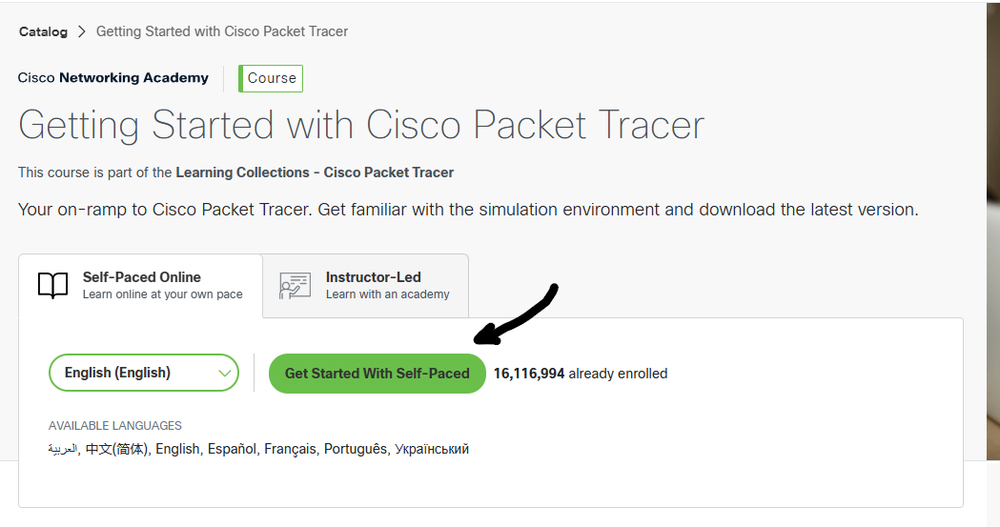

# 📥 Instrukcja pobrania i instalacji Cisco Packet Tracer

Poniżej znajduje się krótki poradnik, jak bezpłatnie pobrać i zainstalować program **Cisco Packet Tracer** za pośrednictwem platformy Cisco Networking Academy (NetAcad).

---

### Krok 1: Założenie konta
1. Przejdź na stronę [Cisco Networking Academy (netacad.com)](https://www.netacad.com/).
2. Załóż bezpłatne konto lub zaloguj się, jeśli już je posiadasz.

### Krok 2: Zapisanie się na kurs wprowadzający
Aby uzyskać dostęp do plików instalacyjnych, wymagane jest zapisanie się na darmowy kurs wprowadzający:
1. Wejdź na stronę kursu: [**Getting Started with Cisco Packet Tracer**](https://www.netacad.com/courses/getting-started-cisco-packet-tracer?courseLang=en-US).
2. Zapisz się na kurs, klikając odpowiedni przycisk na stronie:

### Krok 3: Pobranie i instalacja programu
1. Po zapisaniu się na kurs przejdź do sekcji zasobów do pobrania: [**Lab Downloads – Cisco NetAcad**](https://www.netacad.com/resources/lab-downloads?courseLang=en-US).
2. Pobierz wersję instalatora **Cisco Packet Tracer** odpowiednią dla Twojego systemu operacyjnego (Windows, macOS lub Linux).
3. Zainstaluj program i po jego uruchomieniu zaloguj się za pomocą konta utworzonego na platformie **NetAcad**.
